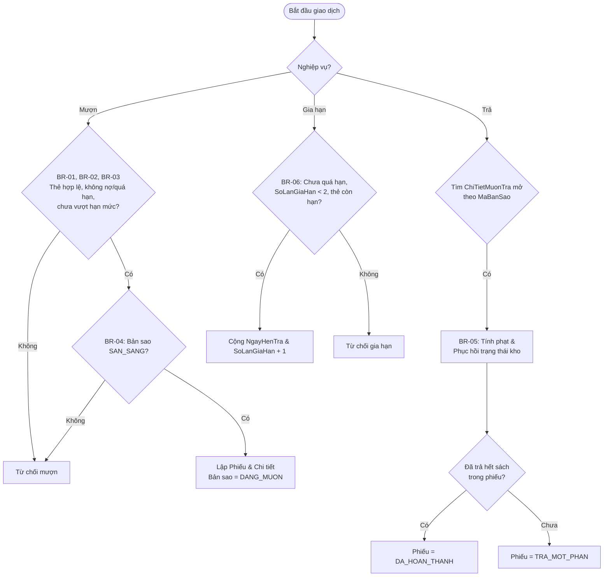

# LibraCore — Hệ thống Quản lý Thư viện

Ứng dụng quản lý thư viện toàn diện được xây dựng theo chuẩn phân tích nghiệp vụ và thiết kế cơ sở dữ liệu quan hệ **5 bảng chuẩn hóa 3NF**, giải quyết triệt để 3 bài toán của mô hình thủ công: quá tải ghi chép/tính toán nhầm lẫn, kiểm soát trạng thái từng cuốn sách vật lý, và tra cứu tài liệu thông minh đa phương thức.

---

## 1. Công nghệ sử dụng

- **Frontend:** React 19, TypeScript, Tailwind CSS v4, Lucide React
- **Backend:** Node.js, Express (`server.ts`), TSX
- **Tìm kiếm ngữ nghĩa AI:** `@google/genai` (`gemini-embedding-2` + Cosine Similarity + Reciprocal Rank Fusion)
- **Lưu trữ dữ liệu:** Hệ thống tệp JSON nguyên tử (`data/library-db.json`) và bộ nhớ đệm vector (`data/embeddings-cache.json`)
- **Build & Tooling:** Vite, esbuild, TypeScript (`tsc --noEmit`)

---

## 2. Cấu trúc thư mục

```text
├── server.ts                     # Express server, API routes (/api/*) & Vite middleware
├── server/
│   ├── db.ts                     # Tầng dữ liệu 5 bảng 3NF, dữ liệu mẫu & engine quy tắc BR-01..06
│   └── search.ts                 # Bộ máy tìm kiếm đa phương án (Truyền thống, PA1, PA2, PA4)
├── src/
│   ├── App.tsx                   # Bố cục workspace chính & điều phối trạng thái
│   ├── index.css                 # Cấu hình Tailwind CSS v4 & typography
│   ├── types/library.ts          # Định nghĩa kiểu TypeScript & hằng số nghiệp vụ
│   ├── utils/format.ts           # Định dạng ngày tháng, tiền tệ VNĐ
│   └── components/
│       ├── DashboardView.tsx     # Tổng quan, cảnh báo quá hạn/sắp đến hạn & thống kê (FR-4.3, FR-4.4)
│       ├── CirculationView.tsx   # Quầy Mượn - Trả - Gia hạn & Thu phạt (FR-3.1..3.4, FR-4.2)
│       ├── CatalogView.tsx       # Quản lý Đầu sách, Bản sao, Kiểm kê & Tìm kiếm (FR-1.1..1.3, FR-4.1)
│       ├── PatronsView.tsx       # Quản lý Độc giả, Thẻ thư viện & Hồ sơ tín dụng (FR-2.1..2.3)
│       ├── SystemBlueprintView.tsx # Trực quan hóa Lưu đồ quy trình & Schema 5 bảng
│       ├── BarcodeSvg.tsx        # Thành phần vẽ mã vạch SVG động cho bản sao & thẻ độc giả
│       └── StatusText.tsx        # Hiển thị trạng thái ngữ nghĩa nhất quán
├── data/                         # Thư mục lưu dữ liệu vận hành & cache embedding
├── index.html
├── metadata.json
└── package.json
```

---

## 3. Tính năng chính

### Nhóm 1: Quản lý Đầu sách, Bản sao & Kiểm kê kho (`FR-1.1` – `FR-1.3`)
- **Đầu sách (`DauSach`):** Thêm, sửa, xóa mềm (`DaXoa = true` để bảo toàn lịch sử), quản lý ISBN, vị trí kệ, giá bìa và mô tả nội dung.
- **Bản sao vật lý (`BanSaoSach`):** Tự động sinh mã vạch duy nhất (`BS-XXXYY`) khi nhập kho; theo dõi vòng đời trạng thái (`SAN_SANG`, `DANG_MUON`, `HU_HONG`, `THAT_LAC`, `THANH_LY`).
- **Kiểm kê kho định kỳ (`KiemKe`):** Nhập/quét hàng loạt mã vạch trên kệ để đối chiếu với trạng thái `SAN_SANG` trên hệ thống, phát hiện chênh lệch và hỗ trợ gắn cờ thất lạc.

### Nhóm 2: Quản lý Độc giả & Thẻ thư viện (`FR-2.1` – `FR-2.3`)
- Đăng ký, cập nhật hồ sơ độc giả theo đối tượng (`SINH_VIEN`, `GIANG_VIEN`, `KHACH`), xem và in thẻ thư viện kèm mã vạch.
- Khóa, mở khóa và gia hạn thời hạn thẻ (`+12 tháng`).
- Theo dõi tức thời số sách đang mượn, lịch sử mượn trả và tổng tiền phạt chưa thanh toán.

### Nhóm 3: Nghiệp vụ Mượn — Trả — Gia hạn & Thu phạt (`FR-3.1` – `FR-3.4`)
- **Lập phiếu mượn:** Kiểm tra tự động `BR-01`, `BR-02`, `BR-03`, `BR-04`; tự động tính `NgayHenTra`; cho mượn nhiều bản sao trên 1 phiếu và hỗ trợ in phiếu mượn.
- **Ghi nhận trả sách (trả từng phần):** Quét trực tiếp mã bản sao `MaBanSao` để truy ngược giao dịch mở, đánh giá tình trạng trả (`BINH_THUONG`, `HU_HONG`, `LAM_MAT`), tính phạt tự động (`BR-05`) và cập nhật trạng thái phiếu (`TRA_MOT_PHAN` / `DA_HOAN_THANH`).
- **Gia hạn sách:** Gia hạn `+7` hoặc `+14` ngày nếu thỏa mãn `BR-06` (chưa quá hạn, `SoLanGiaHan < 2`, thẻ còn hiệu lực).
- **Thu phí phạt:** Hỗ trợ thanh toán tại quầy lúc trả hoặc thu sau theo phiếu, xuất biên lai thu phí phạt (`BL-...`).

### Nhóm 4: Tra cứu đa phương án, Cảnh báo & Báo cáo (`FR-4.1` – `FR-4.4`)
- **Tra cứu OPAC với 4 phương thức kết hợp:**
  1. **Truyền thống:** Khớp chuỗi chính xác theo Tên sách, Tác giả, ISBN, Mã đầu sách, Mã bản sao.
  2. **Phương án 1 (Tìm kiếm mờ & Không dấu):** Chuẩn hóa tiếng Việt không dấu, mở rộng từ viết tắt thư viện (`CSDL`, `CNTT`, `KHTN`...), chịu lỗi chính tả bằng thuật toán Damerau-Levenshtein.
  3. **Phương án 2 (Tìm kiếm ngữ nghĩa AI):** Tạo embedding qua `gemini-embedding-2` kết hợp với từ khóa theo thuật toán Hybrid **Reciprocal Rank Fusion (RRF)**.
  4. **Phương án 4 (Lát cắt động & Đồ thị đồng mượn):** Thống kê lát cắt bộ lọc theo thời gian thực (`Thể loại`, `Vị trí kệ`, `Năm XB`, `Sẵn sàng`) và gợi ý đầu sách thường được mượn cùng phiếu / cùng độc giả / cùng kệ.
- **Cảnh báo & Nhắc hạn:** Lọc sách quá hạn và sắp đến hạn (≤ 3 ngày), gửi nhắc nhở qua Email/SMS và lưu nhật ký nhắc hạn.
- **Thống kê quản trị:** Tỷ lệ tình trạng kho bản sao, top đầu sách mượn nhiều nhất, thống kê theo nhóm độc giả và doanh thu tiền phạt.

---

## 4. Quy tắc nghiệp vụ (`BR-01` – `BR-06`)

| Mã quy tắc | Nội dung kiểm tra |
| :--- | :--- |
| **`BR-01`** | Thẻ độc giả phải ở trạng thái `HOAT_DONG` và `NgayHetHan >= Ngày hiện tại`. |
| **`BR-02`** | Không được mượn mới nếu đang giữ sách quá hạn hoặc còn khoản phạt `DaDongPhat = false`. |
| **`BR-03`** | Hạn mức mượn: Sinh viên tối đa `5` cuốn (`14` ngày), Giảng viên tối đa `10` cuốn (`30` ngày), Khách tối đa `3` cuốn (`7` ngày). |
| **`BR-04`** | Chỉ bản sao trạng thái `SAN_SANG` mới được xuất kho; khi mượn chuyển sang `DANG_MUON`. |
| **`BR-05`** | Phạt trễ hạn `5.000 đ/ngày`; hư hỏng `+50%` giá bìa; làm mất `+100%` giá bìa. |
| **`BR-06`** | Chỉ gia hạn khi chưa quá hạn, `SoLanGiaHan < 2`, và thẻ còn hiệu lực. |



---

## 5. Thiết kế cơ sở dữ liệu (3NF)

1. **`DauSach`** (`MaDauSach` PK, `ISBN` UNIQUE, `TenSach`, `TacGia`, `TheLoai`, `NhaXuatBan`, `NamXuatBan`, `ViTriKe`, `GiaBia`, `MoTa`, `NgayTao`, `DaXoa`)
2. **`BanSaoSach`** (`MaBanSao` PK, `MaDauSach` FK, `NgayNhapKho`, `TrangThai`, `TinhTrangVatLy`)
3. **`DocGia`** (`MaDocGia` PK, `HoTen`, `NgaySinh`, `SoDienThoai` UNIQUE, `Email` UNIQUE, `DiaChi`, `LoaiDocGia`, `NgayCapThe`, `NgayHetHan`, `TrangThaiThe`)
4. **`PhieuMuonTra`** (`MaPhieu` PK, `MaDocGia` FK, `NgayMuon`, `NguoiLapPhieu`, `TrangThaiPhieu`, `GhiChu`)
5. **`ChiTietMuonTra`** (`MaChiTiet` PK, `MaPhieu` FK, `MaBanSao` FK, `NgayHenTra`, `SoLanGiaHan`, `NgayTraThucTe`, `TinhTrangKhiTra`, `TienPhat`, `DaDongPhat`)
6. **Bảng bổ trợ vận hành:** `NhacNho` (nhật ký nhắc hạn), `KiemKe` (biên bản kiểm kê kho) và `EmbeddingCache` (bộ đệm vector ngữ nghĩa).

---

## 6. API Endpoints chính

| Nhóm | Phương thức & Đường dẫn | Chức năng |
| :--- | :--- | :--- |
| **Tra cứu & Kho** | `GET /api/titles/search` | Tìm kiếm đa phương án (`mode=traditional\|fuzzy\|semantic`) + Lát cắt động |
| | `GET /api/titles/:maDauSach/related` | Khám phá sách đồng mượn & cùng kệ |
| | `GET / POST / PUT / DELETE /api/titles` | Quản lý đầu sách (hỗ trợ xóa mềm) |
| | `POST /api/titles/:maDauSach/copies` | Nhập kho bản sao mới & tự sinh mã vạch |
| | `PATCH /api/copies/:maBanSao` | Cập nhật trạng thái bản sao |
| | `GET / POST /api/inventory/audit` | Kiểm kê kho mã vạch & lịch sử kiểm kê |
| **Độc giả** | `GET / POST / PUT /api/patrons` | Quản lý hồ sơ độc giả |
| | `PATCH /api/patrons/:maDocGia/card` | Khóa, mở khóa, gia hạn thẻ thư viện |
| **Lưu hành** | `GET /api/circulation/slips` | Tra cứu danh sách phiếu mượn trả |
| | `POST /api/circulation/borrow` | Lập phiếu mượn (thực thi BR-01..04) |
| | `POST /api/circulation/return` | Ghi nhận trả từng phần & tính phạt (BR-05) |
| | `POST /api/circulation/renew` | Gia hạn sách đang mượn (BR-06) |
| | `POST /api/fines/pay` | Thanh toán tiền phạt & xuất biên lai |
| **Báo cáo** | `GET /api/reports/overview` | Số liệu tổng hợp, top đầu sách & cảnh báo hạn |
| | `POST /api/reminders/send` | Gửi thông báo nhắc hạn Email/SMS |

---

## 7. Cài đặt và khởi chạy

### Yêu cầu môi trường
- Node.js >= 20
- Biến môi trường trong `.env` (tham khảo `.env.example`):
  ```env
  GEMINI_API_KEY="YOUR_GEMINI_API_KEY"
  ```
  *(Cần `GEMINI_API_KEY` để sử dụng tính năng **Phương án 2: Tìm kiếm ngữ nghĩa AI**).*

### Các lệnh phát triển & triển khai

```bash
# 1. Cài đặt phụ thuộc
npm install

# 2. Chạy môi trường phát triển (Express + Vite trên cổng 3000)
npm run dev

# 3. Kiểm tra kiểu TypeScript
npm run lint

# 4. Build cho môi trường production (tạo dist/ và server.js)
npm run build

# 5. Khởi chạy bản production
npm start
```
